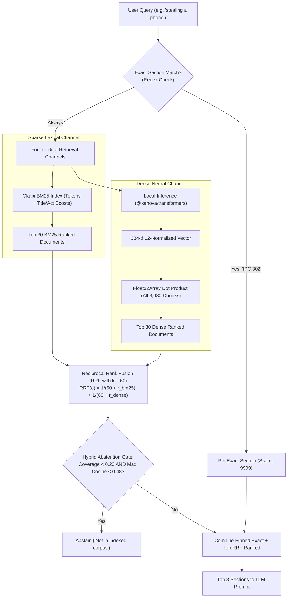

# Architecture Design: Local Dense Embeddings & Reciprocal Rank Fusion (RRF)

**Date:** 2026-11-01  
**Status:** Approved  
**Author:** Antigravity Team  
**Scope:** Upgrade PatraSaar statutory retrieval from pure BM25 lexical search to hybrid dense/sparse retrieval with Reciprocal Rank Fusion (RRF) over all 15 indexed acts (3,630 sections).

---

## 1. Problem Statement & Motivation

PatraSaar's v3 retrieval engine relied on in-process Okapi BM25 keyword matching combined with regex-based exact section pinning. While exact section queries (`IPC 420`, `BNS 103`, `Article 21`) work reliably, semantic/colloquial user queries suffer from the classic **lexical vocabulary mismatch** problem:

- A user asking about _"stealing a mobile phone"_ may fail to retrieve BNS Section 303 (Theft) because the statutory text uses phrasing such as _"whoever intending to take dishonestly any movable property"_.
- In `FUTURE_SCOPE.md` (Week 1–4 of the Capstone Roadmap), this was formally identified as the `q10` theft retrieval weakness.

This design introduces **100% in-process local dense embeddings** fused with **BM25 lexical rankings** via **Reciprocal Rank Fusion (RRF)**, resolving the vocabulary mismatch while maintaining zero external cloud API dependencies, zero runtime subscription costs, and sub-30ms query latency.

---

## 2. Technical Stack & Model Selection

- **Embedding Model:** `Xenova/all-MiniLM-L6-v2` via `@xenova/transformers` (quantized ONNX running on CPU in Node.js runtime).
- **Dimensionality:** 384 dimensions, float32, L2-normalized ($\|v\|_2 = 1.0$).
- **Storage Footprint:**
  - 3,630 sections $\times$ 384 dimensions $\times$ 4 bytes $\approx$ **5.58 MB**.
  - Serialized to flat binary file: `data/corpus-embeddings.bin`.
  - Index mapping: `data/corpus-embeddings-index.json` (array of section IDs in binary offset order).
- **Runtime Overhead:**
  - Memory: ~5.6 MB in RAM.
  - Dot product against 3,630 vectors: $< 2\text{ms}$ on standard CPU.
  - Query embedding inference: ~15–25ms on CPU.

---

## 3. Architecture & Data Flow

---

## 4. Detailed Component Implementation

### 4.1. Precomputed Build Script (`scripts/build-embeddings.ts`)

- Reads `data/corpus.json` (3,630 sections across 15 acts).
- Formats representation: `"${actFull} Section ${number}: ${title}. ${text.slice(0, 500)}"`.
- Generates normalized 384-d vector embeddings using `@xenova/transformers`.
- Writes `data/corpus-embeddings.bin` and `data/corpus-embeddings-index.json`.
- Adds npm script: `"embeddings:build": "tsx scripts/build-embeddings.ts"`.

### 4.2. In-Memory Vector Scanner (`src/lib/corpus/dense.ts`)

- Module-level lazy singleton loader for `corpus-embeddings.bin` into `Float32Array`.
- Cosine similarity via dot-product:
  $$\text{dot}(\vec{q}, \vec{d}_i) = \sum_{j=0}^{383} q[j] \cdot d_i[j]$$
- Returns top $K$ dense hits: `{ id: string, score: number }[]`.
- If binary files are absent or model cannot load, gracefully returns empty results so the system falls back to pure BM25.

### 4.3. Hybrid Fusion & Coverage Gate (`src/lib/corpus/retrieve.ts`)

- Implements standard RRF with smoothing constant $k = 60$:
  $$RRF(d) = \sum_{m \in \{\text{BM25}, \text{Dense}\}} \frac{1.0}{60 + \text{rank}_m(d)}$$
- Exact section matches retain $9999$ priority.
- **Hybrid Abstention Gate**:
  - Abstains if no exact section matches and both lexical coverage is low ($< 0.20$) and peak dense similarity is low ($< 0.48$).
  - Prevents neural hallucination on unindexed domains (e.g. tax, marriage acts) while enabling colloquial semantic matches.

### 4.4. Async Integration

- `retrieve(question, opts)` updated to return `Promise<RetrievalResult>`.
- `src/app/api/chat/route.ts` awaits `retrieve()`.
- `scripts/run-audit.ts` awaits `retrieve()`.
- `tests/unit/retrieve.test.ts` and `tests/unit/verify.test.ts` updated to async calls.

---

## 5. Verification Plan

1. **Unit Tests (`tests/unit/retrieve.test.ts`)**:
   - Verify colloquial query matching: `"stealing a mobile phone"` ranks BNS Section 303 / IPC Section 378 in Top 3.
   - Verify cheque bounce query: `"cheque returned unpaid"` ranks NI Act Section 138 in Top 3.
   - Verify arbitration query: `"court referral to arbitral tribunal"` ranks Arbitration Act Section 8.
   - Verify out-of-corpus questions (e.g. `"What are the current GST rates on textiles?"`) abstain.
   - Verify exact section queries continue to pin with score $9999$.
2. **Deterministic Citation Verification**:
   - Ensure `verifyCitations()` passes all verbatim quote checks on retrieved sections.
3. **Build & Typecheck**:
   - `pnpm typecheck` (zero TypeScript errors).
   - `pnpm lint` (clean ESLint).
   - `pnpm test:unit` (100% passing test suite).
